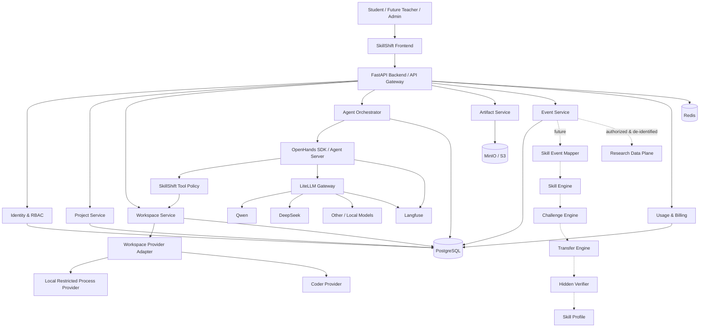
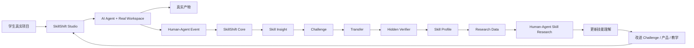

# SkillShift Lab / SkillShift Studio 软件工程总纲 V3.0

> **文件性质**：SkillShift 项目进入产品原型开发阶段后的产品基座总纲；后续《需求规范》《技术规范》《质量规范》的上游输入  
> **版本**：V3.0  
> **日期**：2026-09-23  
> **状态**：产品基座定位已获项目负责人确认；R0 尚未实施，既有研究资料保留且暂停扩展  
> **适用对象**：项目负责人、产品设计、前端开发、后端开发、Agent/AI 工程、数据工程、后续研究人员、指导教师、比赛材料编写人员  
> **首个试点场景**：高职大数据技术专业学生  
> **长期目标**：先构建真实可用的通用 AI Agent Workspace，再在真实产品之上发展 SkillShift Core，形成 AI 时代职业技能动态测量、迁移验证与任务重构体系。

> **2026-09-23 产品定位更正**：`docs/product/R0_PRODUCT_REPOSITIONING_DECISION.md` 已确认 SkillShift Lab 的核心是研究 Agent 冲击下职业教育知识、能力、任务结构和人机协同能力如何变化；Studio 是为该研究提供真实场景、过程数据条件与产品化载体的基础设施。Studio 的 R0 核心是“AI 协同作业过程治理”，而不是与主流 Agent 竞争的通用学生工具。若本总纲中“产品先于研究”“学生为何不用 Codex/Cursor”“独立 Agent Workspace 价值”等旧表述与该决策冲突，以决策记录为准；本总纲将在后续文档任务中统一修订。

---

# 0. 本文件解决什么问题

SkillShift 在前序 V1.0—V2.2 中经历了从“Agent 能力与职业技能研究”到“AI 协同实训平台”的多轮演化。前序研究已经明确了若干有价值的核心思想：

- Agent 正在快速改变编程、数据处理、数据库、系统运维等数字职业任务的完成方式；
- “任务做出来”不再天然等于“学生真正掌握”；
- 单纯禁止 AI 不符合真实职业环境，单纯允许 AI 又会让传统评价失效；
- 需要区分 Human、Agent、Human+Agent、Transfer；
- Hidden Verifier、Task Graph、Evidence Contract、Task-scoped Telemetry 等机制能够为真实能力验证提供基础；
- SkillShift 的长期研究价值不在“输出一个粗糙的职业替代率”，而在于形成细粒度、可重复、可纵向更新的技能迁移证据。

但 V2.2 以前的路线存在一个现实死结：

> **没有真实产品 → 没有真实用户与 Human-Agent 行为数据 → 很难验证研究假设 → 又因为缺少研究证据而不敢大规模开发产品。**

V3.0 对此作出关键转向：

> **先构建一个自身就有真实使用价值的通用 AI Agent Workspace，让学生愿意因为“完成自己的真实学习/项目工作”而使用；再在此真实产品中逐步嵌入 SkillShift Core。数据项目是 R0 的首个验证场景，不是永久产品边界。**

因此，本文件不是推翻 V2.2，而是把此前的研究体系重新排列为：

```text
真实可用产品
    ↓
真实用户
    ↓
真实 Human-Agent 行为
    ↓
SkillShift Core
    ↓
Challenge / Transfer / Hidden Verifier
    ↓
研究数据
    ↓
研究结论
    ↓
反哺产品、能力模型与任务设计
```

**本文件从 2026-09-23 起作为软件工程阶段的总控文件。**

---

# 1. 项目整体命名体系

为避免“产品、研究、技术内核、比赛项目”混在一起，正式采用三级命名。

## 1.1 SkillShift Lab

**含义：整个项目体系。**

SkillShift Lab 包含：

- 产品；
- 软件基础设施；
- Human-Agent 数据；
- SkillShift Core；
- 实验与研究；
- 后续课程/教师/学校扩展；
- 挑战杯等比赛成果。

对外比赛、科研、项目立项时使用此名称。

### 一句话定义

> **SkillShift Lab 是一个以真实 AI 工作产品为载体，研究并支持 AI 时代职业数字技能迁移的人机协作产品与研究体系。**

## 1.2 SkillShift Studio

**含义：学生真正使用的产品。**

首版产品不是 LMS，不是刷题网站，不是普通聊天机器人，也不是只服务单一道实训题的 Demo，而是：

> **面向大数据与计算机专业学生、可逐步扩展到其他数字项目的可执行 AI Agent Workspace。**

学生可以把自己的 Python 项目、CSV / Excel / JSON 数据、SQL、Git 仓库、Notebook、数据分析作业、课程设计、竞赛小项目直接放入 Workspace，让 Agent 在真实隔离环境中读取项目、查看文件、分析数据、运行 Python、执行 SQL、调试报错、修改代码、生成 Notebook / 图表 / 报告、检查环境并协助完成真实工作。

### 产品一句话定义

> **SkillShift Studio 是一个让学生在受控真实项目环境中与 AI Agent 协作、完成代码、数据及其他数字项目工作的通用 AI Agent Workspace。**

### R0 产品边界

R0 先交付“项目 + Workspace + Agent + 人类可见与接管 + 可验证产物 + 事件记录”的通用基座；Python + CSV 数据项目用于验证这条能力链，而不是定义 Studio 只能服务数据任务。后续场景必须复用同一基座，不能为单一课程或实训题重新造一套产品。

## 1.3 SkillShift Core

**含义：未来真正形成项目科研与科技创新壁垒的技术内核。**

包括：

- Skill Event；
- Human-Agent 行为映射；
- Skill Engine；
- Challenge Engine；
- Transfer Engine；
- Hidden Verifier；
- Skill Profile；
- Agent Capability Audit；
- Task Validity / Task Saturation Detection；
- 后续动态任务重构；
- Research Export。

SkillShift Core **不是 Alpha 阶段的前置条件**，但底层数据与后端架构必须从第一天允许它无破坏性接入。

---

# 2. V3.0 的核心共识

## 2.1 当前首要目标不是研究，而是先做出产品

当前阶段最高优先级：

> **做出一个学生可以真正使用、体验成熟、能够处理真实项目的 SkillShift Studio。**

产品自身必须成立。不能依赖老师强制、比赛演示、为研究收数据、做 Skill Check、获得虚拟证书等理由维持使用。

如果没有 SkillShift Core，Studio 仍应具有真实工具价值。

## 2.2 通用 Agent Workspace-first，Challenge-second

旧思路容易变成：

```text
任务库 → 学生实训 → Agent → 评价
```

V3.0 转为：

```text
学生自己的真实任务
        ↓
SkillShift Studio Workspace
        ↓
Agent 帮学生真正完成工作
        ↓
产生 Human-Agent 行为
        ↓
必要时触发 Skill Check / Challenge
        ↓
Transfer / Verifier
        ↓
能力证据
```

固定实训任务不再是产品入口，而是未来的**测量工具**。

R0 的优先级不是堆砌“成熟智能体平台”的全部功能，而是形成一套可扩展的通用 Agent Workspace 基座：用户能在真实项目中让 Agent 读文件、执行受控工具、提出或实施修改、查看验证结果，并能随时批准、拒绝、暂停或接管。一个具体任务只承担首条 Golden Path 的验证职责；验证通过后，基座应支持代码、数据、Notebook、仓库和其他数字项目逐步接入。

## 2.3 不从零造成熟轮子

不把研发资源浪费在通用 Agent Loop、云 IDE、Web Terminal、多模型统一 API、通用 LLM Trace、通用 RAG、通用 Agent Builder、自研基础大模型上。

优先复用成熟底座。

| 能力 | 首选底座 | SkillShift 自研程度 |
|---|---|---|
| Coding / Work Agent | OpenHands SDK / Agent Server | 集成 + 定制工具 |
| Workspace | LocalRestrictedProcessProvider（R0）/ Coder（后期候选） | Adapter 与产品编排 |
| Web IDE | code-server / Monaco / JupyterLab | 产品 UI 集成 |
| Terminal | xterm.js / Coder Web Terminal | 产品 UI 集成 |
| 模型网关 | LiteLLM | 策略、权限、预算接入 |
| LLM Observability | Langfuse | 业务关联 |
| 数据库 | PostgreSQL | 自己设计 Domain Model |
| Queue / Cache | Redis | 自己定义业务任务 |
| Object Storage | MinIO/S3 | Artifact 管理 |
| 通用教学 Agent/RAG | Dify/FastGPT（后期可选） | 非当前核心 |
| Skill Event | 无通用成品 | **自研** |
| Skill Engine | 无通用成品 | **自研** |
| Transfer / Challenge | 无通用成品 | **自研** |
| Hidden Verifier | 项目特定 | **自研** |
| Research Data Plane | 项目特定 | **自研** |

---

# 3. 产品成立的核心问题

SkillShift Studio 必须回答：

> **为什么学生不用 ChatGPT、DeepSeek、Copilot，而要打开 SkillShift？**

不能回答：“因为我们有更多功能。”

必须回答：

> **因为 SkillShift 可以真正进入你的项目环境，理解你的文件、数据、代码和运行状态，并直接帮助你完成真实任务，而不是让你不断复制粘贴上下文。**

首版不追求在模型能力或功能数量上击败 Cursor / Codex / Claude Code，而是聚焦：

> **对“大数据学生”的学习与项目工作进行低门槛整合。**

首个用户群仍以大数据相关学生为主，但这是 R0 获得高密度反馈的切入点，不是产品能力边界。长期竞争力不是“又一个 Agent”，而是让用户在真实项目里得到低摩擦、可控、可验证的协作体验，并为未来 SkillShift 形成可信的 Human-Agent 证据。

---

# 4. 首批目标用户与真实需求

## 4.1 Primary Persona

高职/本科大数据技术、计算机、软件、数据科学学生。

典型特征：

- 学过一点 Python / SQL；
- 会做基础课程任务；
- Agent 使用经验较少或碎片化；
- 遇到环境、依赖、数据、报错问题时容易卡住；
- 不想配置复杂开发环境；
- 经常使用聊天 AI，但仍依赖复制粘贴；
- 有课程作业、课程设计、比赛、GitHub 项目需求。

## 4.2 Jobs To Be Done

学生真正想完成的是：

- 帮我把这个项目跑起来；
- 为什么 Python 报错；
- 帮我分析这个 CSV；
- 这个 Excel 有什么异常；
- 帮我清洗数据；
- 这段 SQL 为什么结果不对；
- 这个 GitHub 项目怎么启动；
- requirements 缺什么；
- 帮我画图；
- 帮我看看 Notebook；
- 我的数据库连不上；
- 这个课程设计怎么开始；
- 帮我理解这段代码；
- 帮我生成一份分析结果，但我要能继续修改。

SkillShift Studio 的产品价值围绕这些真实工作形成。

---

# 5. 产品设计原则

## P1. Product before Research
产品先解决用户问题。研究不能破坏产品体验。

## P2. Real Execution
不能只聊天。Agent 必须在受控 Workspace 内真正看、写、运行、检查并产生产物。

## P3. Artifact-first
最终价值不是聊天记录，而是项目、Notebook、数据、SQL、代码、图表、报告和可运行结果。

## P4. Human-visible Agent
Agent 的计划、操作和结果应可理解，不能变成黑箱自动执行器。

## P5. Progressive Autonomy

### Ask
只回答，不修改和执行。

### Assist
提出计划，重要操作需确认。适用于后续需要更强人工确认的产品策略。

### Agent
在已创建且已绑定给用户的 Workspace 内自主执行。R0 默认采用此模式：Agent 可读写该 Workspace 中的项目文件、运行项目命令、安装项目依赖并访问经策略允许的网络；用户可随时查看、暂停、停止或接管。

这不是宿主机完全访问：Agent 不获得宿主机根目录、私人文件夹、凭据、其他 Workspace 或其他用户数据的访问权。任何跨越 Workspace 边界的动作都应在技术上被拒绝，而不是依赖事后人工批准。

## P6. Backend-first Architecture, Vertical-slice Delivery
后端领域、数据、事件、权限和版本治理从第一天设计正确，但不能“先做三个月后端”；每阶段都必须有真实可运行 vertical slice。

## P7. Event-first
未来 SkillShift Core 的前提不是“保存所有聊天”，而是形成结构化 Human-Agent Event。因此关键操作从第一天事件化。

## P8. Model-agnostic
模型升级应当是变量，而不是项目风险。

## P9. Research-ready, not Research-invasive
产品从第一天具备研究扩展性，但用户产品数据与正式研究数据必须分离。

## P10. General Foundation, Scenario Validation
Studio 的 R0 能力按通用项目工作流设计；首个 Python + CSV 场景只用于验证基座，不得把领域任务字段、规则或流程硬编码为平台前提。

## P11. Human Agency and Verifiable Work
Studio 的差异不在宣称 Agent 更聪明，而在于用户能看见计划和操作、控制关键动作、获得可验证产物，并保留最小必要的人机协作证据。事件记录不是监控，更不是未经效度验证的学生评分。

## P12. R0 Data Boundary
R0 只使用合成数据或项目负责人有权使用的自有示例项目；不导入学生真实隐私数据，不把产品使用等同于研究同意，也不据此输出任何能力评分。

---

# 6. 产品信息架构

## 6.1 当前 Alpha 学生端

```text
SkillShift Studio
├── Home
├── Projects
├── Workspace
├── Data
├── History
├── Usage
└── Settings
```

其中 **Workspace 是绝对核心页面**。

## 6.2 后续 SkillShift Core

```text
SkillShift Studio
├── Home
├── Projects
├── Workspace
├── Data
├── History
├── Skill Check
├── Skill Profile
├── Usage
└── Settings
```

## 6.3 后续教师端

```text
Teacher Workspace
├── Dashboard
├── Cohorts
├── Students
├── Projects
├── Challenges
├── Skill Check
├── Teaching Insights
├── Reports
└── Settings
```

## 6.4 后续 Admin / Ops

```text
Admin Console
├── Overview
├── Users & Roles
├── Workspace
├── Model Gateway
├── Costs
├── Queue
├── Providers
├── System Health
├── Audit Log
└── Settings
```

---

# 7. 核心用户流程

## 7.1 第一次使用

```text
注册 / 登录
    ↓
首页
    ↓
创建项目
    ↓
上传项目 / 导入 Git / 上传数据 / 空白 Workspace
    ↓
创建 Workspace
    ↓
系统扫描项目
    ↓
Agent 给出初始理解
    ↓
用户提出任务
    ↓
Agent Plan
    ↓
真实执行
    ↓
Artifact / 可运行结果
    ↓
项目保存
    ↓
下次继续
```

## 7.2 典型体验

用户上传 `sales-analysis.zip`。

系统识别 Python 项目、数据文件、requirements 与 Notebook。

Agent 首先给出项目理解和计划，而不是直接修改：

> 我已经扫描项目。当前 `analysis.py` 使用 pandas 读取 `sales.csv`，但运行环境缺少部分依赖，同时日期字段可能存在类型问题。我建议先检查依赖并运行现有代码，再决定是否修改。是否开始？

用户在 Workspace 内可观察、暂停、停止或接管；Agent 在已绑定范围内依次检查环境、运行代码、读取错误、查看相关文件、修改、重跑、展示结果并生成 Artifact。

这就是首版必须成立的核心价值闭环。

---

# 8. UI / UX 总原则

## 8.1 参考 TraeWork / TraeCode 的产品范式

参考其 AI-native Workspace 思路，而不是一比一复制视觉：

- Project / Task 中心；
- Prompt-first 入口；
- 工具面板；
- 任务计划可见；
- Artifact 可见；
- Context 与 Runtime 可见；
- AI 工作不只表现为聊天；
- 平台页面 Light-first；
- 开发者工作区可支持 Dark Mode；
- 使用正式 Design System 统一产品。

## 8.2 主 Workspace 布局

```text
┌────────────────────────────────────────────────────────────────────┐
│ SkillShift Studio │ Project │ Runtime │ Model │ Cost │ User         │
├────────────┬────────────────────────────────┬──────────────────────┤
│            │                                │                      │
│  Project   │           Canvas               │      AI Agent        │
│  Explorer  │                                │                      │
│            │ Editor / Notebook / Data       │ Chat / Plan          │
│ Files      │ SQL / Chart / Report           │ Context / Actions    │
│ Data       │                                │                      │
│ DB         │                                │                      │
│ Artifact   │                                │                      │
│            ├────────────────────────────────┤                      │
│            │ Terminal / Logs / Execution    │                      │
└────────────┴────────────────────────────────┴──────────────────────┘
```

## 8.3 视觉原则

禁止：

- 赛博科技大屏；
- 满屏蓝紫渐变；
- 发光描边；
- 粒子动画；
- 卡片套卡片；
- 巨型仪表盘式首页。

采用：

- 清爽；
- 专业；
- AI-native；
- Developer-friendly；
- Data-friendly；
- 强信息层级；
- 弱装饰；
- 强状态反馈。

## 8.4 初步 Design Token

```text
Background      #F7F8FA
Surface         #FFFFFF
Border          #E5E7EB
Primary Text    #172033
Secondary Text  #667085
Brand           蓝色系（正式版另行冻结）
Success         语义绿
Warning         语义橙
Error           语义红
Radius          8–12px
```

具体品牌规范后续在 Figma / TraeWork Design System 中冻结。

---

# 9. 系统总体架构



---

# 10. 架构核心决策

## 10.1 当前采用 Modular Monolith

不要现在微服务化。

后端采用：

```text
FastAPI Modular Monolith
```

理由：

- 团队规模有限；
- 业务仍快速变化；
- 调试成本低；
- 部署简单；
- Domain 可先在代码层隔离；
- 后续真正出现扩展需求再拆服务。

## 10.2 模块化不是文件夹装饰

每个 Domain 需要明确：API、Application Service、Domain Model、Repository、Event、Permission、Test。

禁止跨模块直接随意读写数据库对象。

---

# 11. 后端 Domain 划分

## 11.1 Identity

负责 User、Organization（未来）、Role、Permission、Session、RBAC。

未来角色：

```text
student
teacher
researcher
admin
ops
```

## 11.2 Project

负责 Project、ProjectMember、Git source、metadata、lifecycle。

## 11.3 Workspace

负责 Workspace、Runtime、WorkspaceImage、WorkspaceProvider、ResourceQuota、Session、start / stop / suspend / resume。

业务代码只依赖统一 `WorkspaceProvider`。

首批实现：

```text
LocalRestrictedProcessProvider
CoderProvider
```

## 11.4 Agent

负责 AgentSession、Conversation、AgentRun、AgentPlan、AgentAction、Approval、ToolCall、ToolResult、ModelProfile、AgentPolicy。

OpenHands 是 Agent Runtime，不是 SkillShift 业务 Source of Truth。

## 11.5 Artifact

负责 UploadedFile、Dataset、Notebook、GeneratedReport、Chart、Export、Output Manifest、Hash。

## 11.6 Usage & Billing

负责 Token、Model、Session Cost、User Budget、Project Budget、Provider Cost、Workspace Compute。

LiteLLM 提供模型层数据，SkillShift 仍要保存业务关联。

## 11.7 Event & Audit

这是未来 SkillShift Core 的数据地基。

负责 Domain Event、Human Event、Agent Event、Runtime Event、Audit Event、Schema Version。

## 11.8 SkillShift Core（后续）

```text
Skill Event Mapper
Skill Engine
Challenge Engine
Transfer Engine
Hidden Verifier
Skill Profile
Task Validity
Agent Capability Audit
```

Alpha 不实现核心推断，但必须预留 Event 接口。

## 11.9 Research（后续）

负责 Study、Experiment、Condition、Cohort、Consent、De-identification、DatasetVersion、ResearchExport。

---

# 12. 核心数据模型

最低实体：

```text
User
Role
Permission

Project
ProjectMember

Workspace
WorkspaceSession
RuntimeProfile
WorkspaceImage

AgentSession
Conversation
Message
AgentRun
AgentPlan
AgentAction
HumanDecision

ToolCall
ToolResult

Artifact
FileVersion

ModelUsage
CostRecord

DomainEvent
AuditEvent
```

未来增加：

```text
Skill
SkillEvent
SkillProfile

Challenge
ChallengeRun

TransferTask
TransferRun

Verifier
VerifierRun

Experiment
Condition
ResearchDataset
```

---

# 13. Event-first 数据架构

## 13.1 为什么 Event 比聊天记录重要

未来研究对象不是学生和 AI 说了多少句话，而是：

> AI 提出了什么动作？学生怎样处理？真实环境发生了什么？最后结果如何？

重要事件示例：

```text
project.created
workspace.started

human.agent_request
agent.plan_created

agent.file_read
agent.change_proposed
human.change_approved
human.change_modified
human.change_rejected

agent.tool_called
runtime.command_started
runtime.command_finished
runtime.command_failed

human.file_modified
human.run_requested

artifact.generated

verifier.started
verifier.passed
verifier.failed
```

## 13.2 DomainEvent Schema

```text
event_id
event_type
schema_version

actor_type
actor_id

user_id
project_id
workspace_id
agent_session_id
run_id

target_type
target_id

timestamp

payload

trace_id
correlation_id
```

要求：

- append-oriented；
- 不静默覆盖；
- Schema versioned；
- 核心字段可长期解释；
- payload 不允许无限自由发展。

---

# 14. Langfuse 与 SkillShift Event 的边界

## Langfuse 负责

- LLM Trace；
- Prompt；
- Span；
- Tool observation；
- Token；
- Cost；
- Latency；
- Dataset；
- Experiment；
- AI Eval。

## SkillShift Event 负责

- 人；
- 项目；
- Workspace；
- Human decision；
- Project state；
- 业务事件；
- SkillShift Domain。

> **Langfuse 不是业务 Source of Truth。**

外部观测系统可以替换，SkillShift Domain Event 不能丢。

---

# 15. Agent 架构

## 15.1 OpenHands 定位

OpenHands SDK / Agent Server 用作 Agent Runtime。

复用 Terminal Tool、File Editor、Task Tracker、模型无关、自定义工具、Execution Control 等 Agent 基础能力。

**不直接把 OpenHands Web UI 当 SkillShift 产品。**

## 15.2 SkillShift Agent 工具层

R0 通用工具至少包括：

```text
list_files
read_file
search_files
write_file
run_command
inspect_environment
request_human_approval
```

后续可按数据场景增加：

```text
inspect_dataset
profile_dataframe
preview_table
query_database
execute_sql
execute_notebook
render_chart
check_data_quality
inspect_environment
request_human_approval
```

所有工具必须可授权、可审计、有 schema、有 timeout、有 resource limit、可记录结果、可阻止危险调用。

## 15.3 权限模式

### Ask
只回答，不修改和执行。

### Assist
可读取、运行低风险命令、提出修改；重要写操作或高风险执行需批准。适用于后续需要更强人工确认的产品策略。

### Agent
可进行多步自主执行。R0 默认采用此模式，但能力始终受 Workspace 根目录、非管理员身份、资源配额、工具策略和允许网络范围约束。删除、安装依赖和项目内 Git 操作可在 Workspace 内执行并被完整记录；对宿主机、凭据、其他 Workspace 和超出策略的网络动作必须拒绝。

---

# 16. Workspace 架构

## 16.1 WorkspaceProvider Interface

必须抽象：

```text
create()
start()
stop()
suspend()
resume()
exec()
terminal()
filesystem()
health()
snapshot()
destroy()
```

## 16.2 Alpha

R0 采用：

```text
LocalRestrictedProcessProvider（非 Docker）
```

它为每个 Workspace 创建受控目录，并以非管理员受限进程运行项目命令；文件和进程只能面向该 Workspace 的允许范围。它用于合成或负责人自有项目的 R0 验证，不得被宣称为可安全运行任意恶意代码的生产级沙箱。

## 16.3 MVP / Beta

优先验证：

```text
Coder Provider
```

正式采用前完成许可证、部署、身份认证、资源消耗、API 稳定性专项审计。

---

# 17. Workspace Image

## 17.1 R0 General Project Base Image

```text
Python
uv / pip
Node.js（仅用于运行用户项目；平台前端依赖不进入用户项目）
pandas
numpy
polars
matplotlib
scikit-learn
JupyterLab
Git
SQLite
PostgreSQL client
MySQL client
common CLI tools
```

## 17.2 后续 Data Engineering Image（场景扩展）

```text
DuckDB
Spark
Kafka client
Airflow
```

## 17.3 暂缓

- Hadoop Cluster；
- Flink Cluster；
- Kubernetes；
- 全套大数据生态；
- GPU 环境。

除非真实使用场景证明需要。

---

# 18. 模型网关

## 18.1 LiteLLM

作为统一 Model Gateway，承担 key 管理、cost tracking、rate limiting、routing、fallback、user/team/agent budget。

## 18.2 SkillShift 不绑定具体模型

使用逻辑模型名：

```text
fast-agent
coding-agent
strong-agent
research-agent
```

再映射真实 Provider。业务代码不感知具体模型品牌。

---

# 19. 成本模型

从 Alpha 开始必须存在：

```text
daily_user_budget
monthly_user_budget
project_budget
max_session_cost
max_agent_steps
max_runtime_minutes
```

禁止 Agent 无限循环。

主要成本需要同时记录：

- LLM；
- Workspace CPU/RAM；
- Storage；
- Session duration；
- Network；
- Agent step。

---

# 20. API 设计原则

## 20.1 API-first

统一：

```text
/api/v1/auth
/api/v1/projects
/api/v1/workspaces
/api/v1/agents
/api/v1/artifacts
/api/v1/events
/api/v1/usage
```

后续：

```text
/api/v1/skills
/api/v1/challenges
/api/v1/transfers
/api/v1/verifiers
/api/v1/research
```

## 20.2 UI 不直接绑定基础设施

错误：

```text
Frontend -> Coder API
Frontend -> LiteLLM
Frontend -> OpenHands
```

正确：

```text
Frontend
   ↓
SkillShift Backend
   ↓
Adapter
   ↓
External Infrastructure
```

---

# 21. 前端技术栈

推荐：

```text
Next.js
React
TypeScript
Tailwind CSS
shadcn/ui
Monaco Editor
xterm.js
TanStack Query
Zustand
SSE / WebSocket
```

前端重点是 SkillShift 自己的产品体验，而不是 Fork OpenHands UI 改品牌。

---

# 22. 后端技术栈

```text
Python
FastAPI
Pydantic
SQLAlchemy
Alembic
PostgreSQL
Redis
MinIO / S3
OpenTelemetry（可选基础链路）
```

后端技术栈优先服务长期 Domain、事件、研究与 AI/数据生态。

---

# 23. Repository 结构

推荐 Monorepo：

```text
skillshift/
│
├── apps/
│   ├── web/
│   └── api/
│
├── backend/
│   ├── identity/
│   ├── projects/
│   ├── workspaces/
│   ├── agents/
│   ├── artifacts/
│   ├── usage/
│   ├── events/
│   ├── skillshift/
│   └── research/
│
├── packages/
│   ├── ui/
│   ├── contracts/
│   └── shared/
│
├── infra/
│   ├── docker/
│   ├── coder/
│   ├── litellm/
│   ├── langfuse/
│   ├── postgres/
│   ├── redis/
│   └── minio/
│
├── workspace-images/
│   ├── data-base/
│   └── data-engineering/
│
├── deploy/
│   ├── dev/
│   ├── staging/
│   └── production/
│
├── docs/
│   ├── product/
│   ├── architecture/
│   ├── adr/
│   ├── api/
│   └── research/
│
├── tests/
├── scripts/
├── AGENTS.md
├── README.md
└── PROJECT_MASTER.md
```

---

# 24. 前后端责任边界

## Frontend

负责用户体验、Workspace Shell、Agent Interaction、Editor、Data Preview、Plan、Approval、Artifact 与实时状态反馈。

## Backend

负责权限、Domain、Workspace Lifecycle、Agent Session、Policy、Event、Persistence、Budget、Version、Audit、SkillShift Core Hooks。

> 不在前端保存决定业务正确性的唯一状态。

---

# 25. 教师端、后台与未来升级

V3.0 不立即开发教师端，但 Backend Domain 从现在就避免学生专用的硬编码实体。

应采用：

```text
User
Role
Project
Workspace
AgentSession
Event
Artifact
```

未来 Teacher UI 与 Admin UI 是新的 Client / View，不重新复制核心业务。

---

# 26. 数据分层

```text
Operational Plane
│
├ User
├ Project
├ Workspace
├ AgentSession
├ Usage
└ Artifact
        │
        ├── Event Plane
        │     └ Domain / Human / Agent / Runtime Event
        │
        └── Research Pipeline
              ↓
         consent / filter
              ↓
        de-identification
              ↓
         Research Plane
```

研究数据和产品数据必须分开。

---

# 27. 隐私与研究治理

用户使用 Studio **不等于同意科研使用**。

未来正式研究需要：

- 明确研究目的；
- 知情同意；
- 最小数据原则；
- 去标识化；
- 研究导出版本；
- 数据权限；
- 保留周期；
- 可审计。

教师默认也不能无限制读取学生所有 AI 私人对话。

---

# 28. Versioning

关键版本：

```text
BackendVersion
FrontendVersion
AgentVersion
AgentPolicyVersion
ModelProvider
ModelVersion
WorkspaceImageVersion
ToolVersion
EventSchemaVersion
ChallengeVersion
VerifierVersion
```

未来所有正式实验 Run 必须能回溯这些版本。

---

# 29. SkillShift Core 的升级路径

当前 Studio：

```text
Project
   ↓
Workspace
   ↓
Agent
   ↓
Execution
   ↓
Artifact
```

未来增加：

```text
Project
   ↓
Workspace
   ↓
Agent
   ↓
Human-Agent Event
   ↓
Skill Event
   ↓
Skill Engine
   ↓
Skill Insight
```

必要时：

```text
Skill Insight
   ↓
Skill Check
   ↓
Challenge
   ↓
Transfer
   ↓
Hidden Verifier
   ↓
Skill Profile
```

---

# 30. 与 V2.2 双轨研究的关系

V2.2 中的 Foundation / Agent / Transfer 不删除，但角色变化。

## Foundation
不要求用户一进产品就做。用于能力基线、研究、教师任务、Skill Check。

## Agent
真实 Workspace 本身就是持续 Human+Agent 工作现场。

## Transfer
用于 Skill Check、研究与迁移验证。

---

# 31. Hidden Verifier 的未来定位

Hidden Verifier 不负责评价所有日常 Workspace 行为。

主要用于：

- Challenge；
- Skill Check；
- Research Condition；
- 标准任务。

目标是验证真实环境状态，而不是让 LLM 自己评分。

---

# 32. EDA-V 的位置

EDA-V 保留为任务设计与研究分层方法。

在未获得实验数据前，不包装为“已证明的核心算法”。

未来可以用于任务分类、Challenge 设计、Agent Capability Audit、Skill Transition 分析。

---

# 33. 产品版本路线

## Stage 0 — Engineering Spike

目标：验证关键底座可以组合。

必须打通：

```text
Web
→ Backend
→ Workspace
→ OpenHands
→ LiteLLM
→ Tool
→ Runtime
→ Event
```

### Gate

能够在真实 Workspace：

1. 创建项目；
2. Agent 读取文件；
3. 运行 Python；
4. 返回结果；
5. 提出修改并在需要时获得人类批准后修改文件；
6. 产生结构化 Event。

## Stage 1 — Prototype

目标：项目负责人自己愿意使用。

闭环：

```text
创建项目
→ 上传 ZIP / 项目文件（首个场景为 Python + CSV）
→ 创建 Workspace
→ Agent 扫描
→ Agent 调试
→ 修改
→ 运行
→ 产物
→ 保存
```

Gate：不是 Mock，没有硬编码演示路径。

## Stage 2 — Alpha

目标：5–10 个真实学生可以无需开发人员陪同完成一次真实工作。

必须有：Auth、Project、Workspace、Upload、Agent、Terminal、Editor、Artifact、Persistence、Usage、basic Event。

Gate：至少 5 位真实用户完成自己的真实任务。

重点测：Onboarding、Crash、Agent usefulness、Latency、Cost、Return intention。

## Stage 3 — MVP

目标：成为相对完整、可扩展的独立 AI Agent Workspace。

增加：Git Import、Data Preview、Notebook、SQL、Database、Project History、Model Routing、Budget、Error Recovery、Workspace Lifecycle、Audit。

Gate：20–50 名用户 Pilot。

## Stage 4 — Beta

目标：稳定多用户产品。

增加：Multi-user isolation、Operations Console、Monitoring、Rate Limit、Queue、Deployment、Backups、RBAC、System Health。

Gate：持续运行、无重大数据/权限/隔离问题。

## Stage 5 — SkillShift Beta

增加 Human-Agent Event 语义、Skill Event Mapper、Skill Check、Basic Skill Insight、Challenge、Hidden Verifier。

## Stage 6 — Research / Competition Build

增加 Foundation / Agent / Transfer、Agent Capability Audit、Skill Engine、Research Consent、Research Export、Longitudinal Versioning、Controlled Experiment。

目标：**产品 + 原创数据 + 实证结果。**

## Stage 7 — Mature Product

满足学生主动使用、稳定部署、教师可组织、学校可扩展、SkillShift Core 形成独立价值、研究数据反哺产品。

---

# 34. 关键产品指标

Alpha 不追 DAU 等虚荣指标。

首先看：

## Activation

```text
create project
→ create workspace
→ agent action
→ successful execution
```

## Time to First Value

从注册到第一次“Agent 真正帮我解决一个环境/代码/数据问题”的耗时。

## Completion
Workspace 是否成功完成用户目标。

## Return Intent
用户是否主动想再用。

## Agent Action Quality
多少建议被 accepted、modified、rejected、failed。

## Cost
每个 user、workspace、successful task 的成本。

---

# 35. 后续 SkillShift 指标

未来再研究：

- Human Intervention；
- Validation Behavior；
- Agent Reliance；
- Error Detection；
- Takeover；
- Transfer；
- Skill Profile。

未经效度验证前，不把这些研究指标直接当学生成绩。

---

# 36. 安全

## Workspace

- 隔离；
- resource quota；
- timeout；
- network policy；
- restricted mounts；
- no host root；
- cleanup。

## Agent

- tool allowlist；
- approval policy；
- command risk classification；
- secret masking；
- maximum steps；
- cost cap。

## Database

- migrations；
- backup；
- encryption；
- least privilege。

## Files

- size limit；
- MIME validation；
- dangerous artifact strategy；
- object store isolation。

---

# 37. Testing

## Unit
Domain、Policies、Budget、Event Schema、Tool Policy。

## Integration
PostgreSQL、Redis、Object Storage、LiteLLM、OpenHands、Workspace Provider。

## E2E

至少：

```text
login
→ create project
→ upload
→ start workspace
→ agent
→ tool
→ artifact
→ close
→ reopen
```

## Security
Permission、Cross-user Access、Workspace Escape、Destructive Tool Approval。

## Research-ready
未来增加 Event Completeness、Event Order、Version Reproducibility。

---

# 38. Observability

三层：

## App Observability
API、Error、Latency、Queue、Workspace Health。

## AI Observability
Langfuse：Trace、Token、Cost、Tool、Eval。

## Business Observability
SkillShift：User、Project、Activation、Workspace、Task Completion、Human Decisions。

---

# 39. CI/CD

Pull Request 最低要求：

```text
lint
typecheck
unit tests
migration check
build
security basic scan
```

Staging 自动部署，Production 人工批准。

---

# 40. Definition of Done

Feature 只有同时满足才 Done：

- Spec 完成；
- Acceptance Criteria 通过；
- Unit / Integration 必要测试；
- Error path；
- Permission；
- Event；
- Observability；
- 文档；
- Runtime Verification。

**只写完代码 ≠ Done。**

---

# 41. ADR 机制

重要工程决策必须记录到 `docs/adr/`。

首批：

```text
ADR-001 Modular Monolith
ADR-002 OpenHands SDK
ADR-003 Workspace Provider Abstraction
ADR-004 LiteLLM Gateway
ADR-005 Event-first Architecture
ADR-006 Operational vs Research Data
ADR-007 TraeWork-inspired UI Model
```

以后改路线必须写新 ADR。

---

# 42. 当前明确不做

为了控制项目：

- 不做完整 LMS；
- 不做教务系统；
- 不做大题库；
- 不做考试平台；
- 不做手机 App；
- 不做微信小程序；
- 不自研基础大模型；
- 不自己开发通用 RAG；
- 不自己开发通用 Agent Framework；
- 不自己开发完整云 IDE；
- 不做全桌面监控；
- 不采集无关浏览器历史；
- 不追求全大数据组件一次到位；
- 不在 Alpha 输出未经验证的学生能力评分；
- 不宣传“AI 替代多少专业”。

---

# 43. 主要风险

## 风险 1：Studio 变成弱版 Cursor

处理：不与成熟产品争夺模型能力或功能数量；以通用项目 Workspace、学生低门槛、人类控制、可验证产物和未来 Skill Layer 形成差异。数据项目是切入场景，不是产品锁定。

## 风险 2：为了比赛过早塞 SkillShift Core

处理：产品 Gate 未过，不进入复杂能力评分。

## 风险 3：开源组件集成成本被低估

处理：P0 Engineering Spike 先验证 OpenHands / Coder / LiteLLM / Langfuse。

## 风险 4：Coder 不适合实际部署

处理：WorkspaceProvider 抽象保证可在 R0 的 LocalRestrictedProcessProvider 与后续经过审计的 Provider 间切换。

## 风险 5：Agent 成本 / 循环失控

处理：Budget + Steps + Runtime limits。

## 风险 6：学生数据污染未来研究

处理：Event Schema、Versioning、Operational / Research 分离从第一天落实。

## 风险 7：UI 看起来像学生 Demo

处理：采用正式设计系统、统一组件、TraeWork 式 Workspace 产品逻辑，不追求花哨效果。

## 风险 8：产品过度复杂

任何新增功能必须回答：

> 是否提高真实用户价值，或是否是 SkillShift Core 的必要基础？

两个都不是 → 不开发。

---

# 44. 开发优先级

## P0

- Repo；
- Dev Environment；
- PostgreSQL；
- FastAPI；
- Next.js；
- Project；
- Workspace Abstraction；
- LocalRestrictedProcessProvider（非 Docker）；
- OpenHands；
- LiteLLM；
- First Event；
- 通用文件/命令/自主范围控制工具闭环。

## P1

- Upload；
- File Browser；
- Editor；
- Terminal；
- Agent Panel；
- Approval；
- Persistence。

## P2

- Data Preview；
- Notebook；
- Git；
- Artifact；
- History；
- Usage。

## P3

- Coder；
- Langfuse；
- Admin/Ops；
- Monitoring；
- Security Hardening。

## Future

- SkillShift Core。

---

# 45. 第一个 Engineering Vertical Slice

**唯一目标：**

> 从浏览器让 Agent 在一个真实用户 Workspace 中完成“读取项目 → 运行 → 分析 → 申请批准 → 修改 → 再运行 → 产出事件与 Artifact”的通用 Agent 闭环；Python + CSV 项目是第一条 Golden Path。

演示项目：

```text
project/
├── data/
│   └── events.csv
├── analysis.py
└── requirements.txt
```

故意存在一个真实问题。

流程：

```text
用户上传
↓
Workspace 创建
↓
Agent 扫描
↓
Agent 运行
↓
产生错误
↓
Agent 分析
↓
提出修改
↓
用户查看过程，可随时暂停 / 停止 / 接管
↓
修改
↓
运行成功
↓
生成结果
↓
保存 Artifact
↓
Event 完整记录
```

这条通用能力链不通：

> **禁止开发更高层功能。**

---

# 46. 推荐第一轮 Sprint

## Sprint A — Architecture Spine

产物：Monorepo、FastAPI、Next.js、PostgreSQL、Migrations、Auth Skeleton、Project、Event Schema、ADR、Local Dev Configuration。

## Sprint B — Workspace

LocalRestrictedProcessProvider、Create/Start/Stop、Files、Exec、Health、Timeout。

## Sprint C — Agent

OpenHands、LiteLLM、AgentSession、ToolCall、Approval、Event。

## Sprint D — Product Shell

Home、Project、Workspace、Three-column Layout、Agent Panel、Editor、Terminal。

## Sprint E — First Real Run

运行首个真实 Python + CSV Golden Path，并形成可录屏的完整体验；结论只能证明该场景的基座闭环，不得外推为所有项目类型均已支持。

---

# 47. UI 页面开发顺序

1. Design System；
2. App Shell；
3. Home；
4. Create Project；
5. Workspace；
6. Agent Panel；
7. Editor / Terminal；
8. Artifact；
9. History；
10. Usage；
11. Settings；
12. 后续 Admin；
13. 后续 Teacher；
14. 后续 Skill Check。

---

# 48. TraeWork 参考边界

允许参考：

- AI-native Workspace；
- Task / Project Mental Model；
- Tool Panel；
- Plan Visibility；
- Artifact Visibility；
- Light / Dark Design Logic；
- Design System 方法。

禁止：

- 复制 Logo；
- 复制品牌色；
- 复制具体设计资产；
- 一比一复制页面；
- 复制专有交互动效。

目标：

> **学习范式，不做仿制品。**

---

# 49. 挑战杯关系

V3.0 当前重点不是包装参赛材料。

比赛价值未来由以下事实产生：

```text
真实产品
+
真实用户
+
真实 Human-Agent 数据
+
SkillShift Core
+
对照 / 迁移实验
+
科技方法与产品闭环
```

不能倒序。

---

# 50. 项目最终闭环



---

# 51. 项目最核心的三个资产

未来真正积累的不是页面数量。

## Asset 1：Product
真实学生使用的 SkillShift Studio。

## Asset 2：Data
真实 Human-Agent 行为与可验证结果。

## Asset 3：Method
技能迁移测量、Challenge、Transfer、Hidden Verifier、Skill Engine。

---

# 52. 当前项目状态

## 已冻结

- 研究大方向；
- 产品先行；
- 通用 Agent Workspace-first；
- Python + CSV 作为首个 Golden Path，而非永久产品边界；
- Studio / Lab / Core 分层；
- Backend-first Architecture；
- Event-first；
- Modular Monolith；
- API-first；
- 外部底座策略；
- TraeWork 风格方向；
- Workspace 主产品界面；
- SkillShift Core 延后。

## 尚未证明

- 学生长期真实需求；
- OpenHands 是否完全满足数据任务；
- Coder 是否适合作为最终 Workspace；
- Agent 运行成本；
- Skill Event 是否能形成有效研究信号；
- Skill Engine 效度；
- Challenge / Transfer 的测量效度；
- 产品是否形成长期留存。

这些必须由真实开发和使用证明，而不是计划书假定。

---

# 53. Go / No-Go 原则

## Product Go

满足：

- Workspace 真实可用；
- Agent 真正处理项目；
- 真实学生愿意完成任务；
- 相较复制粘贴聊天 AI 有明显价值。

## Product No-Go / Pivot

若 Agent 无法稳定操作、产品比现有工具明显更麻烦、学生没有第二次使用意愿、核心体验无法形成差异，则调整产品入口，不继续堆功能。

## SkillShift Core Go

必须在 Studio 有真实数据后进入。

## SkillShift Core No-Go / Pivot

如果 Human-Agent Event 没有稳定解释价值、Challenge 无法产生新增能力信息、Transfer 与过程行为无关系、指标不能预测真实新情境表现，则缩减或重构研究主线。

---

# 54. 外部技术验证结论（2026-09-23）

## OpenHands

当前 SDK 适合构建定制 Agent，支持模型无关、Programmatic Task、Custom Tools、Execution Control，并定位为可嵌入产品和内部 AI 平台的 Agent SDK。

结论：

> **适合作为 Agent Runtime 候选，不应直接等同 SkillShift 产品。**

## Coder

当前文档明确提供 Web Terminal，并可通过 Workspace 模板提供 code-server、VS Code Web、Jupyter Notebook、JupyterLab 等 Web IDE / App。

结论：

> **适合作为后期 Workspace Provider 候选，但必须做实际 P0 集成与许可证/部署审计。**

## LiteLLM

当前 Proxy 提供 Auth Hook、Logging、Cost Tracking、Rate Limit，并支持 Customer / User / Team / Agent Budget 与 Session 级限制。

结论：

> **没有必要重新开发多模型成本和预算网关。**

## Langfuse

当前支持 Production Trace、Dataset、Experiment、Live / Offline Evaluation。

结论：

> **适合 AI Observability / Evaluation，但不能代替 SkillShift Domain Event。**

## TraeWork

当前官方设计体系明确区分通用 Light 产品系统和面向 IDE / Agent 的 TraeCode 深色系统；其 Work / Code / Design 以及工具面板都强调任务计划、上下文、运行环境与产物可视化。

结论：

> **SkillShift 应参考其 AI-native Workspace 范式，而不是进行一比一 UI 仿制。**

---

# 55. Source of Truth 优先级

发生冲突时：

1. **本文件 V3.0**；
2. 已批准 ADR；
3. 当前 Product Spec / Feature Spec；
4. V2.2；
5. V2.1；
6. V2.0；
7. R0 V1.0；
8. 旧讨论。

但：

> 任何研究结论仍必须由真实数据验证，本文件不能凭“优先级”把假设变成事实。

---

# 56. 给所有后续开发 Agent 的固定指令

任何 Agent 开始工作前必须理解：

> SkillShift 当前阶段不是建设完整教育平台，也不是建设 SkillShift Core，而是先构建真实可用、可扩展的 SkillShift Studio 通用 AI Agent Workspace。R0 要具备项目、Workspace、Agent、文件与受控命令、用户可见与接管、产物和事件的基本能力；Python + CSV 只是第一条 Golden Path，不得把单一任务或实训流程硬编码为平台边界。R0 使用非 Docker 的 LocalRestrictedProcessProvider，并且只处理合成或负责人自有示例项目；它不访问宿主机私人目录、凭据或其他 Workspace。不得因为 Agent 编码速度快而提前开发教师端、复杂后台、Skill Graph、完整研究平台等未通过 Gate 的功能。所有基础设施尽量通过 Adapter 复用成熟组件；所有关键 Human / Agent / Runtime 行为必须通过结构化 Domain Event 保留未来扩展能力。前端以 AI-native Workspace 为核心，后端以模块化单体、API-first、Event-first、RBAC、版本治理为原则。任何功能必须通过实际运行验证，而不是只检查代码存在。

---

# 57. 当前唯一正确的下一步

不是再写新的宏观计划。

而是：

## **P0 Engineering Spike**

建立仓库并完成：

```text
Browser
   ↓
SkillShift Web
   ↓
FastAPI
   ↓
WorkspaceProvider
   ↓
真实 Python Workspace
   ↓
OpenHands Agent
   ↓
LiteLLM
   ↓
Agent 读 / 跑 / 改文件
   ↓
Event Store
```

只要这条真实链路跑通：

> **SkillShift Studio 正式出生。**

之后按照本文件的 Gate 一步步扩展。

---

# 58. 最终一句话

> **SkillShift V3.0 不再试图先设计一个宏大的 AI 教育平台，也不试图一次做成成熟通用智能体平台；它先做一个真正有人愿意使用的通用 AI Agent Workspace，以 Python + CSV 为首个 Golden Path 验证基础能力，通过真实产品自然形成 Human-Agent 行为数据，再逐步生长出 SkillShift Core，并最终回答 AI 时代“哪些工作交给 Agent、哪些能力仍属于学生、怎样训练与验证这些能力”这一核心问题。**

---

# 附录 A：本文件继承的既有核心思想

来自前序 SkillShift 文档并继续有效的原则包括：

- 不预设“AI 替代基础技能”；
- 不输出简单职业替代率；
- 区分 Performance 与 Learning；
- Human / Agent / Human+Agent 对照；
- Foundation / Agent / Transfer；
- Hidden Verifier；
- EDA-V 作为任务/研究分层；
- Task Graph / Evidence Contract；
- Task-scoped Telemetry；
- 可重复环境；
- Agent / Environment / Verifier Versioning；
- 产品数据与研究数据分离；
- 研究结论可证伪；
- 若核心证据失败，应缩减或停止，而不是靠包装维持项目叙事。

---

# 附录 B：必须持续回答的核心问题

## 产品

- 学生为什么来？
- 为什么第二次还来？
- 为什么不用普通聊天 AI？
- Workspace 是否减少环境与上下文摩擦？
- Agent 是否真的解决问题？

## 工程

- Agent 能否安全稳定执行？
- Workspace 是否稳定？
- Provider 是否可替换？
- 成本是否受控？
- Event 是否完整？
- 数据模型是否支持未来扩展？

## SkillShift

- 哪些行为能够成为 Skill Event？
- Skill Profile 是否有预测力？
- Challenge 是否提供普通产品数据没有的信息？
- Transfer 是否真正测到了 Learning？
- Verifier 是否提供可信 Ground Truth？
- Agent 能力升级后任务是否失效？

## 研究

- 数据是否可以复现？
- 构念是否有效？
- 是否存在混杂变量？
- 样本是否足够？
- 是否过度外推？
- 是否有独立研究信号？

---

# 附录 C：长期产品地图

```text
                    SkillShift Lab
                         │
        ┌────────────────┼────────────────┐
        │                │                │
        ↓                ↓                ↓
SkillShift Studio   SkillShift Core    Research Layer
真实AI工作产品       能力迁移技术       实证研究
        │                │                │
Workspace            Skill Event         Dataset
Agent                Skill Engine        Experiment
Data                 Challenge           Longitudinal
Project              Transfer            Analysis
Artifact             Verifier            Findings
        │                │                │
        └────────────────┼────────────────┘
                         ↓
            Human-Agent Skill Intelligence
                         ↓
              产品 / 教学 / 任务持续迭代
```

---

# 附录 D：与前序文档的关系

本文件基于并整合以下既有资产：

- `SkillShift_项目立项书暨R0研究开发文档_V1.0.docx`
- `SkillShift_Lab_项目立项书暨研究开发文档_V2.0.docx`
- `SkillShift_Lab_项目立项书暨研究开发文档_V2.1.docx`
- `SkillShift_Lab_项目立项书暨研究开发文档_V2.2.docx`

其中：

- V1.0 的职业技能单元、EDA-V、Hidden Verifier、纵向观测与“不能输出粗糙替代率”的原则继续有效；
- V2.0—V2.2 的 Human-Agent 实训、Task Graph / Evidence Contract、Telemetry、数据治理、版本治理、教师/研究扩展设计继续有效；
- V3.0 修改的是**产品启动顺序与产品入口**：由“任务实训优先”转为“真实 Workspace 优先”；
- 原 Foundation / Agent / Transfer 不删除，而是下沉到 SkillShift Core / Challenge / Research 层。

---

# 附录 E：工程验收总原则

任何版本发布前，都必须回答：

1. 这是真功能还是 Demo？
2. 用户能否独立完成？
3. 失败路径是否处理？
4. 权限是否正确？
5. 数据是否可追踪？
6. Event 是否生成？
7. 成本是否可见？
8. 基础设施是否可替换？
9. 是否堵死未来教师端 / SkillShift Core？
10. 是否比上一版本真实提升用户价值？

如果其中关键项无法回答，则不应把版本标为“完成”。

---

**END OF MASTER DOCUMENT — V3.0**
